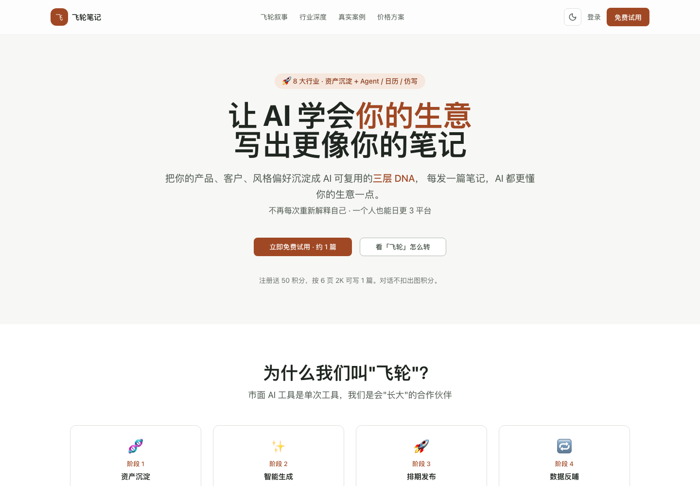
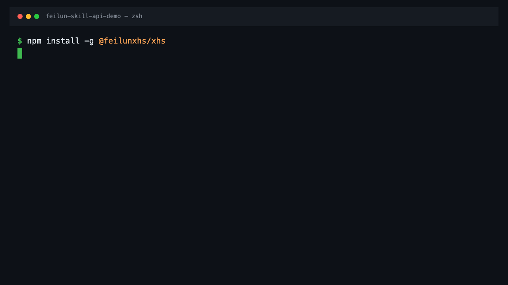
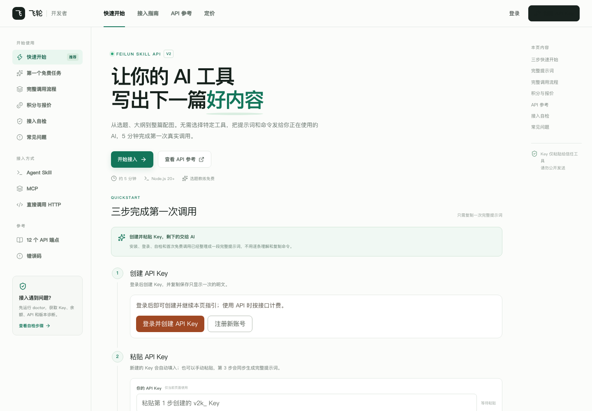

<div align="center">

# 飞轮笔记 · Feilun

### 让 AI 学会你的生意，写出更像你的笔记

面向小红书创作者、品牌运营与内容团队的一站式 AI 内容创作工作台。<br>
从业务资料、选题灵感和内容策略，到图文创作、稿件管理、日历排期与发布，也支持通过 Skill API 接入自己的 AI 工具。

[进入飞轮笔记](https://feilun.ltyfa.top/) · [查看产品功能](docs/product.md) · [快速开始](docs/quickstart.md) · [Skill API 文档](https://feilun.ltyfa.top/api-docs) · [npm](https://www.npmjs.com/package/@feilunxhs/xhs)



</div>

> 本仓库是飞轮笔记的**官方产品介绍、使用指南与公开 API 文档入口**，用于产品展示和接入指引，不提供飞轮 SaaS 源码。

## 一个工作台，完成从灵感到发布

飞轮笔记把内容生产所需的资料、策略、创作和发布环节放在同一套工作流中。你不必每次重新解释自己的业务，也不必在多个工具之间反复搬运稿件与素材。

| 产品板块 | 可以做什么 |
| --- | --- |
| **发现首页** | 查看行业内容、热门笔记与选题灵感，找到值得继续研究的方向。 |
| **写笔记** | 与 AI 一起完成选题、大纲、正文、分页方案与整篇配图。 |
| **稿件** | 集中管理待制作、生成中、待审、已采纳和已发布的内容。 |
| **内容策略** | 结合行业洞察、内容方向和每周节奏，让每篇内容承担清晰任务。 |
| **日历** | 从选题库挑选内容，安排到月历或周视图，再送入稿件制作。 |
| **竞品监控** | 发现同行内容、跟踪账号更新，并将合适的参考笔记用于仿写。 |
| **素材库** | 管理产品档案、行业与内容洞察、人设、知识库及视觉素材。 |
| **发布** | 绑定账号与人设，连接发布助手并管理队列；也可下载内容手动发布。 |
| **Skill API** | 把选题、大纲、改稿、出图和记录查询能力接入外部 AI 工具或工作流。 |

[查看完整产品功能与协作方式 →](docs/product.md)

## 内容如何运转起来

```text
完善业务资料
    ↓
发现灵感 / 研究同行 / 制定内容策略
    ↓
安排选题到内容日历
    ↓
AI 生成大纲、正文与配图
    ↓
审稿、改稿、管理素材
    ↓
确认后发布，或通过 API 接入自己的工具
```

### 业务资料可以持续复用

将产品、客户、内容方向和视觉资料沉淀在素材库中，后续创作可以围绕同一份业务上下文展开。

### 创作过程保留确认环节

先选题和大纲，再改稿与出图。日历安排不会自动发布，收费制作与发布操作以产品页面提示和账号权限为准。

### 网页与 API 使用同一套创作能力

可以直接在飞轮网页中工作，也可以通过 Agent Skill、MCP 或 HTTP，将公开能力接入正在使用的 AI 工具。

## 适合哪些用户

- **个人创作者**：减少资料整理、选题和重复写作的时间。
- **品牌与门店运营**：围绕产品、客户和真实素材持续生产内容。
- **内容团队**：统一策略、稿件、素材、日历和发布流程。
- **开发者与 AI 工具用户**：通过公开 API 构建自己的内容自动化流程。

## 开始使用飞轮 SaaS

1. [注册并登录飞轮笔记](https://feilun.ltyfa.top/)。
2. 在素材库中完善行业、产品、人设和知识资料。
3. 从发现首页、内容策略或竞品监控确定创作方向。
4. 在写笔记中生成内容，或在日历中先安排选题。
5. 在稿件中检查文案和图片，确认后再进入发布流程。

[阅读网页产品与 API 的完整快速开始 →](docs/quickstart.md)

## 开发者：三步完成第一次免费调用

需要 **Node.js 20+** 和一个飞轮账号。最简单的接入方式是打开[三步接入页面](https://feilun.ltyfa.top/api-docs)，创建 Key 后复制完整提示词，发送给你信任的 AI 工具。

也可以手动执行：

### 1. 安装飞轮 Agent Skill

```bash
npx -y @feilunxhs/xhs init --agent auto
```

### 2. 登录并检查接入

在[公开 API 文档](https://feilun.ltyfa.top/api-docs)中创建 API Key，然后执行：

```bash
npx -y @feilunxhs/xhs login
npx -y @feilunxhs/xhs doctor --agent
```

`login` 会提示你安全输入 Key。不要把真实 Key 写入命令历史、代码、GitHub Issue 或公开聊天。

### 3. 完成一次免费选题

```bash
npx -y @feilunxhs/xhs coach '{"topic":"北京合租找房避坑","pageCount":5}'
```

成功响应会返回叙事角度、目标读者和标题方向候选。免费 coach 限额为**每账户每滚动 24 小时 30 次**，同一账户的多个 Key 共享额度。



## Skill API 能接入哪些能力

| 能力 | 说明 | 计费方式 |
| --- | --- | --- |
| 健康检查、余额与流水 | 检查接入状态、积分余额和 Skill API 消耗记录 | 免费 |
| 选题教练 | 生成角度、读者与标题方向候选 | 免费，账户级限次 |
| 生成大纲 | 创建可继续修改的图文 record | 按接口计费 |
| 整组与单页改稿 | 调整大纲和分页内容 | 免费 |
| 整篇出图 | 明确确认后提交异步图片任务 | 按确认报价计费 |
| 单页重出 | 对指定页面重新生成图片 | 按页报价 |
| 记录与稿件查询 | 查询进度、最终 record 和生成的稿件 | 免费 |

完整提供 **12 个公开端点**，支持幂等键、乐观锁、异步进度查询和标准化错误响应。

[查看公开 API 摘要](docs/api.md) · [进入完整 API 文档](https://feilun.ltyfa.top/api-docs) · [MCP 与 HTTP 接入](docs/quickstart.md#方式三mcp-或直接调用-http)



## Key、计费与重试安全

- API Key 只应保存在可信的本地凭据或密钥管理系统中。
- MCP 配置不填写 Key，先完成本地登录，再复用凭据。
- 大纲、整篇出图和单页重出必须携带 `Idempotency-Key`。
- 网络中断后先查询 record 和积分流水，不要盲目更换幂等键重试。
- 出图是异步任务，提交后通过 record 查询进度，不应长时间阻塞等待图片。
- 遇到 `429` 时按照 `retryAfterSec` 或 `Retry-After` 等待。

[阅读安全与计费指南 →](docs/security.md)

## 文档导航

| 文档 | 内容 |
| --- | --- |
| [产品功能全景](docs/product.md) | 飞轮 SaaS 各模块及完整内容工作流 |
| [快速开始](docs/quickstart.md) | 网页产品、Agent Skill、MCP 与 HTTP 接入 |
| [公开 API 摘要](docs/api.md) | 12 个端点、调用顺序、异步任务与错误约定 |
| [安全与计费](docs/security.md) | Key 保管、积分对账、幂等与限流 |
| [常见问题](docs/faq.md) | 安装、登录、版本、出图与发布问题 |

## 公开范围说明

本仓库仅包含公开文档和可公开展示的演示素材，不包含：

- 飞轮前端、后端、管理端或部署源码；
- 内部 Prompt、生成规则、完整 Skill 内容与模型编排逻辑；
- 数据库、服务器、内部接口或超管功能；
- 真实用户稿件、账号、积分流水或密钥。

已发布的 npm 包是独立的公开分发物，请以 npm 包页面和公开 API 文档为准。本仓库的公开不代表飞轮 SaaS 开源。

## 支持与反馈

- 产品问题：先查看[常见问题](docs/faq.md)。
- API 接入问题：运行 `npx -y @feilunxhs/xhs doctor --agent`，再对照[在线自检指南](https://feilun.ltyfa.top/api-docs#self-check)。
- 文档纠错或展示建议：通过 GitHub Issues 提交，**不要附带 API Key、账号信息或用户稿件**。

[服务条款](https://feilun.ltyfa.top/terms) · [数据与隐私](https://feilun.ltyfa.top/privacy) · [更新日志](https://feilun.ltyfa.top/changelog)

---

<div align="center">
<strong>飞轮笔记 · 让创作长出复利</strong><br>
<a href="https://feilun.ltyfa.top/">进入产品</a> · <a href="https://feilun.ltyfa.top/api-docs">开发者文档</a>
</div>
